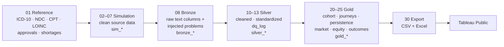
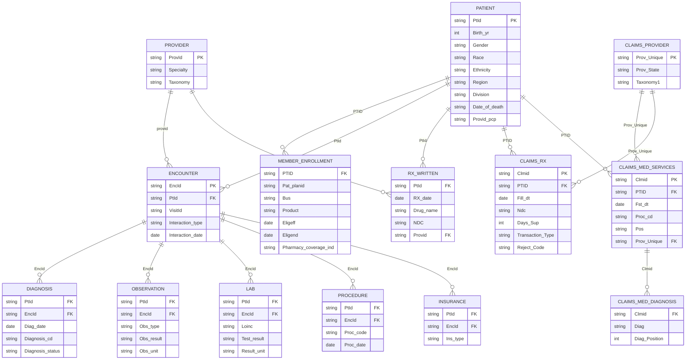
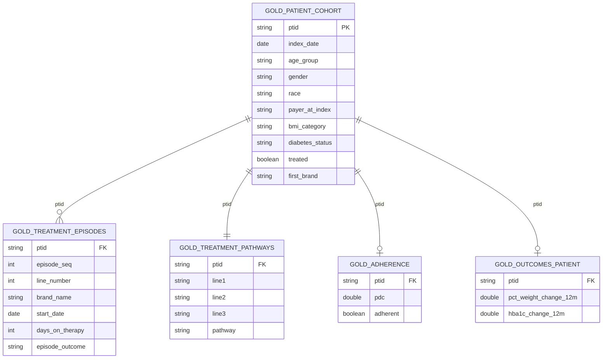

# GLP-1 & Obesity Treatment: Real-World Evidence Analytics

**Databricks (PySpark · Spark SQL · Delta) → Tableau Public**

An end-to-end real-world-evidence (RWE) project from the point of view of a pharma **market analytics
team**. It builds a patient cohort from linked claims + EHR data, cleans realistic messy source data,
and answers the questions brand, market-access and medical-affairs teams ask about the anti-obesity and
GLP-1 market from 2018 to 2025.

> **All patient data in this project is simulated.** No real patient, provider or payer data is used.
> The simulation follows real-world rules checked against public sources (FDA labels and shortage
> notices, CDC coding guidance, CMS coverage guidance). See [`docs/verified_reference.md`](docs/verified_reference.md).

**Contents:** [Business questions](#business-questions) · [Study design](#study-design) ·
[Architecture](#architecture) · [Schema](#schema) · [Data tables](#data-tables) ·
[Data quality](#data-quality) · [Methods](#methods) · [Dashboards](#dashboards) · [How to run](#how-to-run)

---

## Business questions

| # | Question | Dashboard |
|---|---|---|
| 1 | Who is eligible for anti-obesity treatment, and what do they look like? | Cohort & patient profile |
| 2 | How has the market shifted between products? How did the 2022–2025 shortages and new launches change new starts? | Market trends |
| 3 | Which product do patients start on, and what happens when they stop? | Treatment journey |
| 4 | How long do patients stay on treatment, and do they take it as prescribed? | Persistence & adherence |
| 5 | Are some groups less likely to be treated after accounting for clinical need and insurance? | Equity of access |
| 6 | How much weight (and HbA1c) do patients lose in routine care? | Real-world outcomes |
| 7 | How trustworthy is the data, and what had to be fixed? | Data quality |

---

## Study design

Retrospective, observational **new-user cohort** study. Full protocol: [`docs/study_protocol.md`](docs/study_protocol.md)

```
   Baseline (180 days)            Index date (day 0)               Follow-up (variable)
|------------------------------|---------------------------------------------------------------->|
 continuous coverage             first obesity evidence,           treatment start & product
 comorbidities, baseline BMI     or overweight + comorbidity,      lines, switching, persistence
 exclusions: T1D, pregnancy,     2018-01-01 to 2025-12-31          adherence (PDC), weight & HbA1c
 prior surgery, prior AOM use                                      ends: coverage end / death / 2025-12-31
```

| Element | Definition |
|---|---|
| Data source | Simulated linked commercial claims + EHR (2016–2025) |
| Identification period | 2018-01-01 to 2025-12-31 |
| Index date | First obesity code, BMI Z-code ≥ 30 or measured BMI ≥ 30, **or** overweight with a weight-related comorbidity |
| Inclusion | Age ≥ 18; continuous medical + pharmacy coverage 180 days before and after index |
| Exclusion | Type 1 diabetes; pregnancy around index; bariatric surgery before index; any GLP-1 / anti-obesity fill in baseline (new users only) |
| Exposures | Tirzepatide (Mounjaro, Zepbound), semaglutide (Ozempic, Wegovy, Rybelsus), liraglutide (Victoza, Saxenda, generics), dulaglutide (Trulicity), Qsymia, Contrave |
| Outcomes | Treatment within 12 months, first-line product, lines of therapy, persistence, PDC, % weight change, HbA1c change, market share, payer rejections |
| Covariates | Age, sex, race, ethnicity, region, payer, BMI class, comorbidities, index year |
| Analysis | Descriptive statistics, Kaplan-Meier, Wilson CIs, multivariable logistic regression |

**Cohort attrition** (from `gold_cohort_attrition`):

| Step | Rule |
|---|---|
| 0 | All patients |
| 1 | Obesity, or overweight + comorbidity, 2018–2025 |
| 2 | Age 18+ |
| 3 | Continuous coverage ±180 days |
| 4 | No type 1 diabetes |
| 5 | Not pregnant around index |
| 6 | No prior bariatric surgery |
| 7 | New users (no baseline GLP-1 / AOM fill) |

---

## Architecture



| Layer | Purpose | Notebooks |
|---|---|---|
| `ref_*` | Verified code lists and market events | 01 |
| `sim_*` | Clean simulated source data (answer key, never used by the analysis) | 02 – 07 |
| `bronze_*` | Raw landing tables: all text, with real-world data problems | 08 |
| `silver_*` | Cleaned, standardized, de-duplicated tables + data-quality log | 10 – 13 |
| `gold_*` | Analysis-ready tables that feed Tableau | 20 – 25 |

---

## Schema

### Source data model (bronze)

The source tables follow the structure of a linked commercial claims + EHR research database.
`PtId` / `PTID` links every table to the patient; `EncId` links EHR records to an encounter;
`Clmid` links claim diagnoses to claim lines.



### Analysis data model (gold)

`gold_patient_cohort` is the hub. Every patient-level gold table joins to it on `ptid`.



Summary tables (no patient key): `gold_cohort_attrition`, `gold_persistence_curve`,
`gold_persistence_summary`, `gold_market_monthly`, `gold_market_share_annual`, `gold_access_annual`,
`gold_market_events`, `gold_switch_matrix`, `gold_equity_rates`, `gold_equity_adjusted_or`,
`gold_outcomes_summary`, `gold_dq_tables`, `gold_dq_rules`.

---

## Data tables

Row counts are from a full run with 50,000 simulated patients (fixed random seed, so every run gives the same data).

### Bronze (raw)

| Table | Rows | Cols | Contents |
|---|---:|---:|---|
| `bronze_patient` | 50,150 | 20 | Demographics, death month, PCP, EHR activity months |
| `bronze_member_enrollment` | 56,829 | 13 | Insurance coverage spans, payer, plan product, pharmacy coverage |
| `bronze_encounter` | 750,230 | 9 | Office, telehealth, emergency and inpatient encounters |
| `bronze_diagnosis` | 835,227 | 13 | EHR diagnoses (ICD-10-CM) with diagnosis status |
| `bronze_claims_med_services` | 652,704 | 15 | Medical claim lines (CPT, place of service, cost) |
| `bronze_claims_med_diagnosis` | 692,940 | 8 | Claim diagnosis codes |
| `bronze_claims_rx` | 95,750 | 30 | Pharmacy claims: paid, rejected and reversed |
| `bronze_rx_written` | 30,050 | 22 | EHR prescriptions written (including never-filled) |
| `bronze_observation` | 936,672 | 12 | Weight, BMI and height readings |
| `bronze_lab` | 126,189 | 18 | HbA1c results (NGSP % and IFCC mmol/mol) |
| `bronze_procedure` | 919 | 10 | Bariatric surgery procedures |
| `bronze_insurance` | 372,462 | 6 | Payer recorded at EHR encounters |
| `bronze_provider` / `bronze_claims_provider` | 3,125 each | 5 / 6 | Provider specialty, taxonomy, state |
| **Total** | **≈ 4.6 million** | | |

### Reference

| Table | Rows | Contents |
|---|---:|---|
| `ref_product` | 12 | Brand, generic, manufacturer, class, approval and availability dates |
| `ref_ndc` | 35 | Real NDC codes by product and label dose step (10- and 11-digit) |
| `ref_icd10` | 41 | Obesity, BMI, comorbidity and exclusion codes with valid-from/to dates |
| `ref_procedure` | 7 | Bariatric surgery and visit CPT codes |
| `ref_loinc` | 4 | HbA1c (NGSP and IFCC), BMI, body weight |
| `ref_market_events` | 8 | Shortages, coverage change, coding change, generic entries |
| `ref_geography` | 51 | Census region → division → state |
| `ref_specialty` | 7 | Provider specialties with NUCC taxonomy codes |

### Silver and Gold

Listed with every column in [`docs/data_dictionary.md`](docs/data_dictionary.md).

---

## Data quality

Problems injected into the raw layer (each counted in `dq_injection_log`) and how the Silver layer fixes them (each logged in `dq_log`):

| Problem in raw data | Fix |
|---|---|
| NDCs in 4 formats (11-digit, hyphenated 5-4-2, 10-digit labeled, leading zeros lost) | Standardized to 11-digit 5-4-2, matched to `ref_ndc` |
| Paid claims later reversed | Claim and reversal removed together |
| Days supply 0, 999 or blank | Replaced with the product's standard days supply |
| Fills after death; patients missing from the patient table | Removed |
| ICD-10 codes with/without dots, lower case, spaces; ICD-9 leftovers | Standardized; ICD-9 removed |
| Retired code E66.8 used after Oct 2024 | Remapped to E66.89 |
| Weight in lb/kg with inconsistent or missing units; decimal shifts; height as `5' 6"` | Converted to kg/cm; missing units inferred from the patient's other readings; implausible values removed |
| HbA1c in IFCC mmol/mol without unit; "Pending" / "<4.0" | Converted to NGSP %; non-results removed |
| Gender / race / region spelled many ways; impossible birth years | Standardized; invalid years set to NULL |
| Enrollment dates swapped, overlapping spans, 3 date formats | Parsed, swapped back, merged |
| Exact duplicates in every table | Removed |

---

## What makes the simulation realistic

**Real-world rules (verified):**
- Products appear only after US approval (Wegovy June 2021, Zepbound November 2023 …)
- Real NDC codes and label dose escalation (Wegovy 0.25 → 0.5 → 1 → 1.7 → 2.4 mg)
- FDA shortages (semaglutide 2022 – Feb 2025, tirzepatide Dec 2022 – Oct 2024) reduce new starts and interrupt refills
- Medicare Part D excludes weight-loss drugs; Wegovy coverable for its CV indication from March 2024 only. Other Medicare weight-loss use is cash-pay and invisible in claims
- New obesity class codes (E66.811–E66.813) from October 1, 2024, adopted gradually
- First generic liraglutide 2024; Saxenda generic 2025; bariatric surgery declines as GLP-1 use grows

**Simulation assumptions (not real statistics):** uptake, payer and demographic effects (including a
deliberate access gap so the equity analysis has something to find), discontinuation and switching,
weight-loss sizes, costs and copays.

---

## Methods

| Analysis | Method |
|---|---|
| Treatment episodes | Fills per product; > 60-day gap after supply runs out = stop |
| Lines of therapy | New line when a different product starts; restart of the same product = same line |
| Persistence | Kaplan-Meier; event = discontinuation; censored at end of follow-up |
| Adherence | PDC over 365 days; adherent = PDC ≥ 0.80 |
| Market | Monthly fills (TRx proxy), new-to-brand starts (NBRx proxy), share, payer rejections |
| Equity | Crude rates with 95% Wilson CIs; adjusted odds ratios from logistic regression (IRLS in NumPy), overall and by diabetes status |
| Outcomes | % weight change and HbA1c change at 6 and 12 months; all starters vs persistent patients |

---

## Dashboards

| Dashboard | Main visuals |
|---|---|
| 1 · Cohort & patient profile | Attrition funnel, demographics, BMI class, comorbidities, payer mix |
| 2 · Market trends | Monthly fills and new starts with shortage / approval markers, annual share, rejection rates |
| 3 · Treatment journey | First-line product mix, top pathways, switch matrix, episode outcomes |
| 4 · Persistence & adherence | Kaplan-Meier curves, 12-month persistence, PDC distribution |
| 5 · Equity of access | Treatment rates with CIs, adjusted odds-ratio forest plot |
| 6 · Outcomes | Weight change by product, share reaching 5/10/15% loss, HbA1c change |
| 7 · Data quality | Bronze vs silver rows, rules applied |

🔗 **Tableau Public:** _link to be added_ · 📸 [`tableau/screenshots/`](tableau/screenshots/) ·
Build guide: [`docs/tableau_dashboard_guide.md`](docs/tableau_dashboard_guide.md)

---

## How to run

1. Databricks → Workspace → Create → **Git folder** → paste this repository's URL.
2. Attach serverless compute (or any Unity Catalog cluster).
3. Run `notebooks/99_run_pipeline` (≈ 15–25 min), or notebooks `01` → `30` in order.
4. Download the exports: Catalog → `glp1_rwe` → Volumes → `tableau_exports`.
5. Tableau Public → Connect → Microsoft Excel → `glp1_obesity_rwe_tableau.xlsx`.

Settings (schema, patients, study window, analysis rules) live in `notebooks/00_setup/00_config`.

---

## Repository structure

```
notebooks/
  00_setup/       00_config                        settings + helper functions
  01_reference/   01_reference_codes               verified code lists
  02_simulation/  02–07 sim_*                      simulated source data
                  08_build_bronze_with_dq_issues   raw layer + injected problems
  03_silver/      10–12 cleaning · 13 data-quality report
  04_gold/        20 cohort · 21 journeys · 22 persistence/adherence
                  23 market · 24 equity · 25 outcomes
  05_export/      30_export_for_tableau
  99_run_pipeline
docs/
  study_protocol.md            full study protocol
  data_dictionary.md           every table and column
  verified_reference.md        real-world facts and sources
  tableau_dashboard_guide.md   dashboard build guide
tableau/                       workbook (.twbx) and screenshots
```

---

## Limitations

- Simulated data: results show the method, not real product performance or real disparities.
- Claims capture only plan-paid fills; cash-pay use (common for weight-loss drugs) is missed. This is modeled on purpose.
- Events after 2025 (oral obesity GLP-1s, 2026 Medicare changes) are outside the study window.
